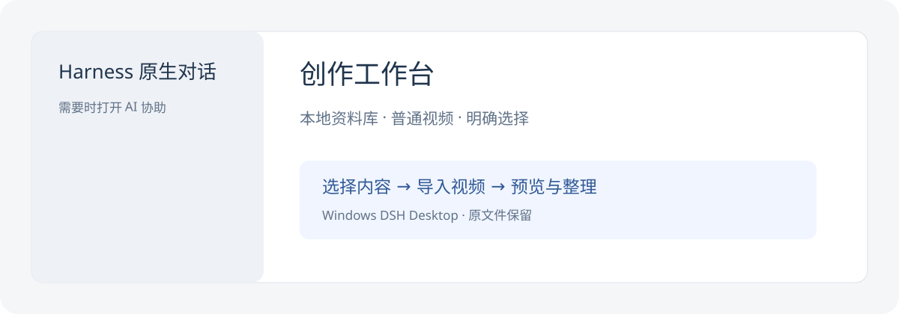

# 创作工作台

运行在 Windows DSH Desktop 内的本地创作工作台。在同一个项目中写脚本、文章、制作图片或导入视频，使用 Harness 原生 Agent，并为各平台分别准备发布材料。



选择资料库 → 创建或选择项目 → 制作需要的内容 → 准备各平台材料 → 上传、核对并手动发表。创建时只需标题；文章与图文可以独立完成。见[统一创作与平台发布](docs/unified-publishing.md)。

- 顶部依次为概览、视频、脚本、字幕、文章、图片、发布。概览汇总成果，点击进入对应页面。
- 文章页支持文稿编辑、未保存预览和保存新版本；图片页统一管理配图与视频封面，各处图片通过同一弹窗预览。
- 发布页以固定平台入口和独立材料组织文案、图序、上传结果及作品数据，公众号可直接进入设置；编辑自动保存，上传前固定成功版本。
- 支持 MP4、MOV，包括大写扩展名；来源不限，独立字幕可选。
- 导入时复制文件，保留原文件；同名不覆盖，可修改导入名称重试。
- 多个视频时明确选择，选择按资料库保存；选中文件消失时提示重新选择。
- 左侧使用 Harness 原生对话，右侧管理内容。未开始对话也可以管理视频，需要 AI 协助时点击「打开项目对话」进入当前项目目录。
- 工作台内部左侧始终展示项目列表，右侧展示所选项目；窄窗口中的表单、封面和图片在各自容器内重排。
- 从列表移除视频仅改变产品显示，磁盘文件保留；移除当前视频后明确清空选择，需要时重新导入原文件即可加入。
- 三画幅封面支持导入、预览、版本选择和单画幅重做；新图片通过检查后再选用，原版本保留。
- 点击「让 Agent 制作封面」准备原生会话草稿，发送后由当前 Agent 看图分析并生成；没有单独的视觉模型设置。
- 生图设置为服务根地址、模型和 API Key，使用 OpenAI 兼容 images 接口。凭据存入 Harness；不会自动借用聊天或旧厂商 Key。
- 外部 Skill、凭据或模型缺失只影响对应增强能力，片库、视频管理和已有封面导入独立可用。
- 网络请求结果未确认时不自动重发。工作台显示真实任务状态，重试前需要核对。

## 本地开发

工具链：Node 22.19+，pnpm 10.16.1。Stage A 的隔离验证使用 Node 22.23.4。
目标应用：DSH Desktop 0.12.1，随附 Harness 0.2.1-rc.2。

```sh
pnpm install --frozen-lockfile --ignore-scripts
pnpm check
node scripts/check-workbench-package.mjs
npm pack --ignore-scripts --pack-destination .artifacts
node scripts/check-workbench-package.mjs .artifacts/dsh-creator-workbench-0.7.0.tgz
```

`pnpm check` 包含类型检查、构建、依赖边界检查与测试。构建仅写当前仓库的 lib，不直接修改 Desktop。
打包后使用当前 Desktop 配套的插件管理入口安装；加载、入口与真实业务验证分别记录在 [本地自测](docs/market-selftest.md)。
本地安装不涉及工作台市场投稿。

## 设计与后续阶段

文件是正文的真实来源；每期一个目录。配置、当前视频选择与状态保存在独立的 `~/.dsh-creator-workbench`，可与原工作台并存。
导入通过 Desktop 的文件路径桥接和宿主后台任务执行，视频字节不经过 JSON Remote。

参见 [使用指南](docs/usage.md)、[文件约定](docs/files.md) 与 [模块边界](docs/implementation.md)。
0.4.1 保留原生对话、历史侧栏、右侧详情和五个页签顺序，支持视频与封面管理、火山转写、WeWrite HTML 文章、小红书／抖音／B站视频草稿准备及手动运营数据同步。项目移除后可从原目录重新加入并恢复原会话，见 [状态与交互说明](docs/state-ux.md)。
封面复用 oil-cover，视频上传复用 video-publisher；公众号写作、文字检查、排版和草稿能力复用 WeWrite。文章默认查看排版 HTML，可编辑源稿和历史版本保留；最终发表由人确认。

0.6.0已完成 Windows 本机安装与核心流程验收；0.7.0发布面板、自动保存和图片预览的当前检查与本机验收状态见 `publishing-autosave-image-preview` Change。视频号、公众号远端草稿与数据回收继续待验收；已发表作品的自动状态回写已有回归测试，尚待匹配真实作品验证。设置、使用方式和各能力验证边界见 [Windows 发布与 WeWrite 说明](docs/windows-publishing.md)。

## 来源与许可

Fork 自 [oil-oil/dsh-oil-creator](https://github.com/oil-oil/dsh-oil-creator)，基线提交 `58bd30d0d05b04e149552e8bdb4ff0becae614f0`。
保留原项目历史与 [MIT 许可](LICENSE)。当前 Fork：[qinghui316/dsh-creator-workbench](https://github.com/qinghui316/dsh-creator-workbench)。

### 项目保存位置

支持多个父目录和统一项目列表。设置中更换默认位置立即生效；新建项目可单次选择位置，已有文件夹可直接加入。操作与迁移说明见 [项目与保存位置](docs/project-locations.md)。
